<p align="center">
  
</p>
<h1 align="center">Morka</h1>
<p align="center"><strong>Wish there were an AI-powered desktop app for that?</strong><br>
Just tell Morka what you want. It handles the rest.</p>
<p align="center">
  <a href="https://github.com/mithrisys/morka/releases"><strong>Download Morka</strong></a>
  · <a href="#quickstart">Quickstart</a>
  · <a href="docs/app-authoring.md">App authoring</a>
  · <a href="docs/architecture.md">Architecture</a>
</p>
<p align="center">
  <a href="https://github.com/mithrisys/morka/actions/workflows/ci.yml"></a>
</p>

Morka turns the tools you wish you had into desktop apps you can run, refine, and share. Use the AI agents you already have on your computer. With Codex or Claude Code, your existing subscription can power both the work of building your app and the AI features inside it, without a separate API key or API bill. Morka takes care of project setup, dependencies, builds, and live preview.

## Install Morka

Grab the desktop preview from [GitHub Releases](https://github.com/mithrisys/morka/releases). The downloads bundle Node.js and npm.

| Platform | Install the desktop preview |
| --- | --- |
| macOS · Apple Silicon | Open the DMG and drag Morka into Applications. |
| Windows · x64 and ARM64 | Run the setup executable for your architecture. |
| Linux · x64 and ARM64 | Install the `.deb` on Debian or Ubuntu with `sudo apt install ./morka-*.deb`, or the `.rpm` on Fedora with `sudo dnf install ./morka-*.rpm`. Open **Morka** from the application menu. |

The Linux tarball remains available for portable use on systems that permit Electron's sandbox. On Ubuntu 24.04 and newer, use the `.deb` to configure the app's AppArmor profile at installation. All Linux formats include Node.js and npm.

Each release provides `SHA256SUMS.txt` and notes on platform support, signing, and upgrades.

## Quickstart

1. Launch Morka. Swipe right on the launcher or focus the create control and press Enter. Name your app and pick a folder. To launch an existing app, select **or wake up a morka…** and choose its folder, choose a ZIP or TAR.GZ archive, or enter its Git URL.
2. Open **AI setup** to check your local agent sign-in.
3. Open **Chat**, select an agent, and describe what you want.

```text
Build a desktop app for my meeting notes. Save notes locally and add a
button that turns the current note into a short list of action items.
```

Your agent works in a draft while the app stays open. Morka builds the change, checks that the app starts and its page loads, then publishes the source to your checkout. You can keep chatting to refine the result.

New apps include accessible form and layout defaults and fast Node test scripts. Type `/review` in app chat to run app checks and exercise the main workflow at two desktop sizes. Direct stylesheet edits keep the current page and input in place. See [workflow review](docs/preview-scenarios.md).

## AI in your apps

An **agent action** lets a button or another app control call Codex or Claude Code through Morka. The app sends the action the data it needs, such as the current meeting note, and gets back validated JSON it can use in the UI. Morka asks for permission before the app first uses a local account, and the account stays with the host.

You can also choose an [Agent Client Protocol (ACP) agent for project chat](docs/app-authoring.md#agents-and-chat-sessions). For an action manifest and JSON Schema example, see the [agent action guide](host/skills/morka-agent-action/SKILL.md).

## Your app is a Git repo

Every app gets a source checkout with its own dependency lockfile. Chat history, account permissions, and app data live in a private profile outside the source. Each chat gets its own draft. If a build or preview check fails, Morka keeps the last working release running and saves the draft for repair.

```text
my-app/
├── app/                    # Editable source and app dependencies
│   ├── morka.project.json  # Runtime, project rules, and agent actions
│   ├── package.json
│   └── package-lock.json
├── .morka/                 # Launcher and release metadata
├── package.json            # Pinned Morka runtime and packager
└── package-lock.json
```

Reuse instructions, agent skills, and assets across apps with [Shadows](docs/app-authoring.md#plugin-shadow). For the preview lifecycle and release layout, see [Architecture](docs/architecture.md).

## Share your app

Publish your app's Git repository so others can open it in Morka or run it with `npm ci` and `npm start` from the app repository root. Recipients connect their own supported agent account for AI features.

On macOS, run `npm run package:mac` from the app repository after `npm ci` to create a self-contained `.app` in `dist/`. The packaged release includes Node.js and its prepared dependencies, so it can launch offline. See the [app authoring guide](docs/app-authoring.md#work-with-a-project-repository) for local install and launcher commands.

## Run Morka from source

Use Node.js 24 or newer and npm to build the Morka host.

```sh
git clone https://github.com/mithrisys/morka.git
cd morka
npm ci
npm start
```

See [Contributing](CONTRIBUTING.md) for the development workflow, [Changelog](CHANGELOG.md) for release notes, and [GitHub Issues](https://github.com/mithrisys/morka/issues) for bug reports and feature requests.

## License

Morka is distributed under the [MIT License](LICENSE). Bundled third-party components retain their own licenses.
